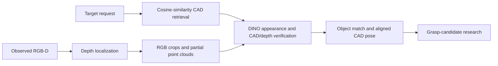

# CAD-Guided NIST Object Identification

Research on identifying manufacturing parts from a requested CAD model and a
single RGB-D observation, then generating grasp candidates from the aligned CAD.
Current scene and CAD generation use NIST Task Board 1.



The component modules and controlled studies exist. The complete
retrieval-to-grasp workflow has not been validated as one autonomous system.
Grasp candidates do not establish physical pickup, holding or assembly success.

## Start here

- [Published results and visual examples](results/README.md): summaries,
  per-object errors, detailed grasp decisions and selected figures.
- [Cloud analysis guide](docs/cloud_analysis.md): reading order, useful analysis
  questions and the limits of a GitHub checkout.
- [Experiment index](experiments/README.md): current and historical study scopes.
- [Pipeline contract](simulation/pipeline_protocol.md): units, frames and evidence rules.

## Files used by each stage

| Stage | Main files |
|---|---|
| CAD library and cosine retrieval | [CAD/cad_library.json](CAD/cad_library.json), [helper_function.py](helper_function.py) — `CADRetrieval` accepts an embedding function and ranks CAD text metadata |
| Calibrated RGB-D input | [camera_capturing.py](camera_capturing.py), [simulation/libero_sensor.py](simulation/libero_sensor.py), [simulation/libero_io.py](simulation/libero_io.py) |
| Depth localization and RGB crops | [point_cloud_localization.py](point_cloud_localization.py) — table/cluster localization; [visualize_localization_projection.py](visualize_localization_projection.py) — projection, masks and crop bounds |
| DINO global and foreground-patch features | [scripts/cad_descriptors.py](scripts/cad_descriptors.py), [scripts/sam6d_patch_matching.py](scripts/sam6d_patch_matching.py), [run_dino.py](experiments/nist12_qwen_clip_reranking_20261023/run_dino.py) |
| CAD/depth fitting and verification | [scripts/surface_verification.py](scripts/surface_verification.py), [geometry.py](experiments/nist12_qwen_clip_reranking_20261023/depth_verification_20261023/geometry.py) — native-scale support hypotheses, table-plane refinement, silhouette/depth agreement |
| Tested DINO/depth fusion | [select_results.py](experiments/nist12_qwen_clip_reranking_20261023/depth_verification_20261023/select_results.py) — historical experiment selector |
| Reusable table-constrained alignment | [CADPointCloudRegistration.py](CADPointCloudRegistration.py) |
| Grasp inputs and finite-hand geometry | [inputs.py](experiments/cad_grasp_geometry_20261026/inputs.py), [geometry_kernel.py](experiments/cad_grasp_geometry_20261026/geometry_kernel.py), [hand_model.py](experiments/cad_grasp_geometry_20261026/hand_model.py) |
| Current grasp sampler and checks | [upstream.py](experiments/cad_grasp_method_comparison_20261026/upstream.py), [pair_reduction.py](experiments/cad_grasp_method_comparison_20261026/pair_reduction.py), [run_compare.py](experiments/cad_grasp_method_comparison_20261026/run_compare.py), [alignment_filter.py](experiments/cad_grasp_method_comparison_20261026/alignment_filter.py) |
| NIST scenes and reference views | [simulation/nist_task_board_1.py](simulation/nist_task_board_1.py), [simulation/nist_capture.py](simulation/nist_capture.py), [simulation/nist_cad_views.py](simulation/nist_cad_views.py) |

The historically named `nist12_qwen_clip_reranking_20261023` folder still houses
tested DINO/depth code. Its frozen CLIP-top-five study is a comparison with its
own assumptions; the folder name does not make Qwen or CLIP mandatory in the
current framework. Cleanup did not convert that runner into a new benchmark.

## Repository structure

```text
CAD/             Retrieval catalog, source models and asset provenance
simulation/      NIST scene/capture helpers and shared simulator backend
scripts/         Descriptors, geometry checks and capture utilities
experiments/     Our study code, configurations, protocols and documentation
results/         Selected exact copies of saved evidence for GitHub/cloud review
tests/           Shared regression tests
docs/            Cloud handoff, current protocol context and cleanup record
outputs/         Mostly local generated data, caches, captures and galleries
```

The twenty catalog meshes are included at their existing
`outputs/simulation/nist_task_board_1/assets/meshes/` paths, with conversion
[provenance](CAD/NIST_ASSET_NOTICE.md). Other `outputs/` content is local except
the dataset README and small cleanup receipts explicitly allowed by
[.gitignore](.gitignore).

Local data locations:

- `outputs/datasets/nist_task_board/`: shared captures, camera metadata,
  crops and CAD reference views.
- `outputs/datasets/nist_task_board/legacy_workspace_inputs/`: required legacy
  NIST scene, camera/state metadata and USB CAD assets relocated from the retired
  C: experiment workspace.
- `outputs/simulation/`: NIST board and five/seven-part figure variants.
- `outputs/cad_grasp_*/`: complete grasp-study outputs and galleries.
- `outputs/cache/`: installed models, baseline dependencies and tools.
- `outputs/physical/` and `outputs/recovered/`: physical captures/calibration.

LIBERO/robosuite remain simulator and Panda dependencies. Their installed robot
assets and textures do not enable additional object-layout generators.

## Results available on GitHub

The [evidence bundle](results/README.md) contains 83 exact-copied files,
about 22.25 MiB: classification decisions, per-object and error tables,
depth pin-case illustrations, current grasp decisions and eight contact-atlas
images. [bundle_manifest.json](results/bundle_manifest.json) records each
original path, byte count and SHA256. No new inference, fitting or accuracy
evaluation was performed to publish these copies.

[.gitattributes](.gitattributes) preserves result and pinned experimental bytes
across platforms. Raw captures, feature arrays, exhaustive fit/pose banks,
downloaded packages, model weights and temporary files are excluded from Git.
Copied historical reports keep their original links; the evidence index points
to the figures actually included.

Keep these claims separate:

- Recognition studies usually supply a known CAD, so their accuracy does not
  measure upstream text-to-CAD retrieval.
- Matching-module comparisons share crops; native full-scene methods generate
  their own proposals.
- Grasp studies assume correct CAD/crop correspondence and saved observed-depth
  alignment. The current [recommendation](experiments/cad_grasp_method_comparison_20261026/recommendation.md)
  uses the released `one` sampler, nearby-pair reduction, downward Panda
  conversion and modeled checks with one-degree local contact selection.
- The retained robustness scope is 220 NIST inputs and 2,720 queries.
  Classification accuracy evaluation remains incomplete.

Preserve native metric scale, camera calibration, unavailable fits and ties.
State the searched pose degrees of freedom. Single-view partial clouds and
symmetric parts can leave orientation unresolved. Simulator identities and
poses are audit-only, never recognition/alignment inputs. Scores are uncalibrated.

## Local execution

The commands below target the existing local WSL environment **with its cached
assets and dependencies**. This is not a complete fresh-cloud installation recipe.

```bash
PY=/home/jiabao/.venvs/lerobot-libero/bin/python
$PY -B -m pytest -q -p no:cacheprovider tests
MUJOCO_GL=egl PYOPENGL_PLATFORM=egl $PY -m scripts.capture_nist_task_board
```

Capture writes simulated output. Tests/runners requiring omitted captures, fit
banks or installed models cannot be reproduced from source and summaries alone.
`requirements-association.txt` lists only part of the dependency stack:
geometry also uses SciPy, simulation uses MuJoCo/robosuite/LIBERO/LeRobot,
and optional physical capture uses RealSense. Historical description studies
also require their declared local model backend.

Cloud analysis can inspect source, CAD meshes and published evidence without
claiming a rerun. Do not download weights, install environments, start paid APIs
or command a physical robot as a side effect of analysis or default checks.

## Cleanup and historical evidence

The October 27 cleanup removed retired VLM likelihood experiments and results,
plus non-NIST layouts. Shared NIST inputs were extracted before deletion.
Current grasp work, native CAD assets, installed dependencies and physical
calibration/captures were preserved.

Path migrations did not recompute saved numerical outcomes. Original source
inventories describe the original checkout; they do not certify reorganized
sources as the original run. See [cleanup_20261027.json](docs/cleanup_20261027.json).

The separate C: experiment workspace was also removed after its required inputs
and editable presentation assets were copied to D: and hash-verified. Saved
results keep their historical path strings; maintained readers resolve that
specific retired workspace prefix to the D: dataset location. Scene XML changes
are restricted to asset-path attributes and recorded in a verified migration
receipt. See [the C: cleanup record](docs/c_workspace_cleanup_20261027.json).
