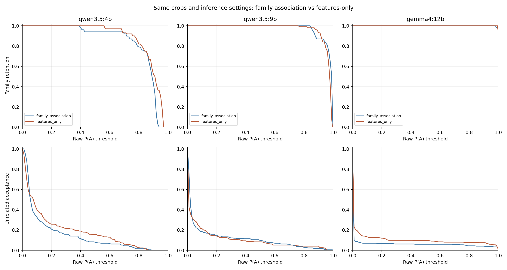
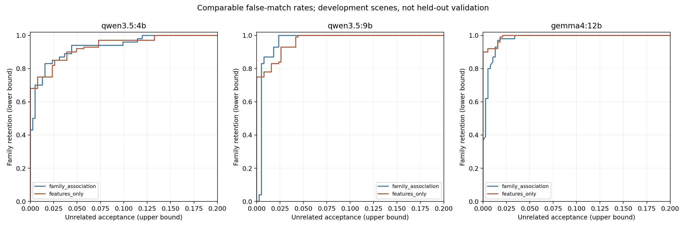

# Features-Only Association: Paired Local Experiment

## GitHub / GPT Cloud Entry Point

This is the **features-only association condition**, compared directly with the
[unchanged family-association condition](../family_association_20260926/README.md).
The [earlier four-model baseline](../vlm_four_scene_20260925/README.md) is also preserved.

- [All paired-condition scores](all_scores_comparison.json), [paired differences](paired_scores.csv).
- [Exact model-visible prompts](selected_prompts.json), [physical descriptions](descriptions.json).
- [Per-family results](per_family_metrics.csv), [threshold sweeps](threshold_sweep.csv).
- [Matched false-match operating points](matched_false_match_operating_points.csv).
- [Specific confusion pairs](known_failure_pairs.csv), [top unrelated matches](top_unrelated_pairs.csv).
- [Threshold chart](threshold_comparison.png), [matched-rate chart](family_retention_vs_false_matches.png).
- [Qwen4B heatmaps](qwen3.5-4b/four_scene_heatmaps.pdf), [Qwen9B heatmaps](qwen3.5-9b/four_scene_heatmaps.pdf), [Gemma heatmaps](gemma4-12b/four_scene_heatmaps.pdf).

All 1,452 new raw responses are included. Canonical table paths resolve from this
folder; baseline responses and the 44 unchanged input crops are referenced from
the sibling experiment folders, without duplication. Names in tables and charts
are evaluation metadata only, not model-visible text. Raw records and files in
`provenance/` preserve their original local paths and bytes. The provenance scripts
document the local experiment; they are not portable inference entry points.

Run this offline verification from the repository root:
`python tools/verify_family_results.py experiments/features_only_20260926`

No models, credentials, GPU, or network are needed for verification. No inference
was rerun during publication. No acceptance threshold or model was deployed.
The local ZIP is intentionally excluded; its evidence is available as individual
versioned files here. Use the repository verifier above, not the local-workspace
verification commands quoted later in the original report.

1,452 new calls: three local models, four frozen scenes, 11 targets x 11 candidates per scene. Direct baseline: the immediately preceding family-association condition, not the older exact-object trial.

## Controlled Comparison
- Same 44 RGB rectangle crops, crop hashes, target/candidate ordering, model digests, Ollama version, inference settings and raw probability extraction.
- Only task wording, label meanings and descriptions change together. This does not isolate the causal effect of removing names alone.
- Exact supplied descriptions are preserved in descriptions.json. No names, IDs, sizes or category headers appear in either model-visible prompt. Names in charts are evaluation labels only.
- All size variants share identical full prompts, but were executed independently to preserve pairing. These are correlated repeated queries, not independent trials.
- P(A)=exp(raw logp_A), without normalization, calibration or filtering. P(C) is a token probability; emitted-C frequency is reported separately.
- Missing exact top-logprob values stay null with conservative bounds, never imputed as zero.
- Two USB crops (states 101 and 303) remain assisted recoveries. Autonomous-depth-only tables exclude all comparisons against them. M8 and square pins remain excluded.
- Original family results and earlier baseline files remain unchanged, checked by SHA-256.

## Results at P(A) >= 0.70
| Model | Condition | Family AUC | Family /100 | Unrelated /384 | Own /44 | C labels /484 |
|---|---|---:|---:|---:|---:|---:|
| qwen3.5:4b | family_association | 0.9862 | 92 | 17 | 40 | 303 |
| qwen3.5:4b | features_only | 0.9866 | 93 | 23 | 41 | 71 |
| qwen3.5:9b | family_association | 0.9927 | 100 | 23 | 44 | 186 |
| qwen3.5:9b | features_only | 0.9935 | 100 | 20 | 44 | 62 |
| gemma4:12b | family_association | 0.9955 | 100 | 22 | 44 | 52 |
| gemma4:12b | features_only | 0.9985 | 100 | 31 | 44 | 0 |

## Matched False-Match Limits
Both conditions select their own threshold under the same maximum unrelated-acceptance count. These are optimistic development-set operating points, not validated gates.
| Model | Maximum unrelated /384 | Family: previous -> features | Actual unrelated: previous -> features |
|---|---:|---:|---:|
| qwen3.5:4b | 0 | 43 -> 68 | 0 -> 0 |
| qwen3.5:4b | 5 | 75 -> 75 | 5 -> 3 |
| qwen3.5:4b | 14 | 89 -> 85 | 14 -> 10 |
| qwen3.5:4b | 20 | 94 -> 92 | 17 -> 19 |
| qwen3.5:9b | 0 | 0 -> 75 | 0 -> 0 |
| qwen3.5:9b | 5 | 87 -> 78 | 3 -> 3 |
| qwen3.5:9b | 14 | 100 -> 93 | 9 -> 10 |
| qwen3.5:9b | 20 | 100 -> 100 | 9 -> 17 |
| gemma4:12b | 0 | 37 -> 90 | 0 -> 0 |
| gemma4:12b | 5 | 93 -> 92 | 5 -> 2 |
| gemma4:12b | 14 | 100 -> 100 | 13 -> 8 |
| gemma4:12b | 20 | 100 -> 100 | 13 -> 8 |

## Specific Confusions
At .70, the first three rows per model are unrelated false matches; true-nut rows should be retained.
| Model | Case | Accepted: previous -> features | Pairs | C labels: previous -> features |
|---|---|---:|---:|---:|
| qwen3.5:4b | Waterproof <- DSUB | 3 -> 2 | 4 | 0 -> 0 |
| qwen3.5:4b | DSUB <- USB | 4 -> 0 | 4 | 0 -> 0 |
| qwen3.5:4b | Gear <- hex nut | 9 -> 9 | 24 | 3 -> 0 |
| qwen3.5:4b | True nut family crops | 8 -> 12 | 16 | 0 -> 0 |
| qwen3.5:9b | Waterproof <- DSUB | 3 -> 1 | 4 | 0 -> 0 |
| qwen3.5:9b | DSUB <- USB | 4 -> 0 | 4 | 0 -> 2 |
| qwen3.5:9b | Gear <- hex nut | 9 -> 18 | 24 | 6 -> 0 |
| qwen3.5:9b | True nut family crops | 16 -> 16 | 16 | 0 -> 0 |
| gemma4:12b | Waterproof <- DSUB | 4 -> 1 | 4 | 0 -> 0 |
| gemma4:12b | DSUB <- USB | 4 -> 0 | 4 | 0 -> 0 |
| gemma4:12b | Gear <- hex nut | 3 -> 15 | 24 | 0 -> 0 |
| gemma4:12b | True nut family crops | 16 -> 16 | 16 | 0 -> 0 |

## Per-Family Results
| Model | Family | Family retained: previous -> features | Family pairs | Unrelated accepted: previous -> features | Unrelated pairs |
|---|---|---:|---:|---:|---:|
| qwen3.5:4b | gear | 36 -> 33 | 36 | 9 -> 9 | 96 |
| qwen3.5:4b | hex_nut | 8 -> 12 | 16 | 0 -> 0 | 72 |
| qwen3.5:4b | round_pin | 36 -> 36 | 36 | 0 -> 3 | 96 |
| qwen3.5:4b | Waterproof_Male | 4 -> 4 | 4 | 4 -> 10 | 40 |
| qwen3.5:4b | USB_Male | 4 -> 4 | 4 | 0 -> 0 | 40 |
| qwen3.5:4b | DSUB_Male | 4 -> 4 | 4 | 4 -> 1 | 40 |
| qwen3.5:9b | gear | 36 -> 36 | 36 | 9 -> 18 | 96 |
| qwen3.5:9b | hex_nut | 16 -> 16 | 16 | 0 -> 0 | 72 |
| qwen3.5:9b | round_pin | 36 -> 36 | 36 | 3 -> 0 | 96 |
| qwen3.5:9b | Waterproof_Male | 4 -> 4 | 4 | 5 -> 2 | 40 |
| qwen3.5:9b | USB_Male | 4 -> 4 | 4 | 0 -> 0 | 40 |
| qwen3.5:9b | DSUB_Male | 4 -> 4 | 4 | 6 -> 0 | 40 |
| gemma4:12b | gear | 36 -> 36 | 36 | 3 -> 15 | 96 |
| gemma4:12b | hex_nut | 16 -> 16 | 16 | 0 -> 0 | 72 |
| gemma4:12b | round_pin | 36 -> 36 | 36 | 0 -> 6 | 96 |
| gemma4:12b | Waterproof_Male | 4 -> 4 | 4 | 8 -> 5 | 40 |
| gemma4:12b | USB_Male | 4 -> 4 | 4 | 1 -> 1 | 40 |
| gemma4:12b | DSUB_Male | 4 -> 4 | 4 | 10 -> 4 | 40 |

## Insufficient Evidence
| Model | Condition | Family mean P(C) | Family C /100 | Unrelated mean P(C) | Unrelated C /384 |
|---|---|---:|---:|---:|---:|
| qwen3.5:4b | family_association | 0.08357 | 0 | 0.62481 | 303 |
| qwen3.5:4b | features_only | 0.01589 | 0 | 0.26394 | 71 |
| qwen3.5:9b | family_association | 0.02144 | 0 | 0.49824 | 186 |
| qwen3.5:9b | features_only | 0.02483 | 0 | 0.23084 | 62 |
| gemma4:12b | family_association | 0.00001 | 0 | 0.14191 | 52 |
| gemma4:12b | features_only | 0.00000 | 0 | 0.00211 | 0 |

## Saved Evidence
- all_scores_comparison.csv/json: all 2,904 old/new comparisons with P(A/B/C), log probabilities, labels, crop hashes, raw-response paths and evaluation identities.
- paired_scores.csv/json: 1,452 matched comparisons and score differences.
- metrics.csv/json and per_family_metrics.csv/json: AUC, macro-family AUC, mean P(C), C frequency, per-scene and assisted-crop sensitivity.
- baseline_comparison.csv/json: paired aggregate AUC differences and changes in family/unrelated C counts for each scene and both crop scopes.
- threshold_sweep.csv/json, per_family_thresholds.csv/json: family, unrelated and own-object retained counts and rates.
- matched_false_match_operating_points.csv/json: thresholds and retention at common false-match budgets.
- known_failures.csv/json, known_failure_pairs.csv/json: requested connector/gear-nut confusion directions.
- top_unrelated_pairs.csv/json, ranked_unrelated_pairs.csv/json: top 20 and complete false-match rankings per model/condition.
- repeated_family_query_consistency.csv/json: score variation among identical size-family prompts in both conditions.
- Each model directory contains 484 raw responses, runtime provenance, four annotated heatmaps and a four-page PDF.
- selected_prompts.json and prompt_audit.json: exact model-visible text and category-name leakage checks.
- results.zip contains the analysis, new and paired baseline raw responses, 44 input crops and source helpers under their workspace-relative paths.

Offline verification after extraction: `python features-only-ablation/verify_results.py`. This validates the bundled raw data without models, a network connection, or the entire older workspace.

## Interpretation Limits
These scenes were already used to develop the prompts. AUC and optimized operating points are descriptive development results, not held-out estimates. Scores are not calibrated probabilities of physical correctness. Own-object retention does not prove exact-size recognition. No threshold is deployed, and no existing condition is replaced.

